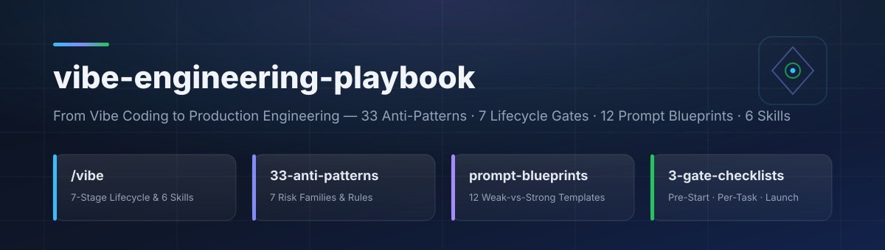

<div align="center">



<br/>

**دليل تعليمات هندسي ثنائي اللغة + ٦ مهارات وكلاء صافية ([Agent Skills](https://agentskills.io)) وأمر `/vibe` لبناء برمجيات إنتاجية منضبطة بالذكاء الاصطناعي — يستبدل القبول الأعمى بالمواصفات المسبقة، والنقد الصارم، وبوابات التحقق الفعلية.**

[](https://github.com/abduallahJamal/vibe-engineering-playbook/actions/workflows/validate.yml)
[](#مهارات-الوكلاء-الست-وأمر-vibe)
[](docs/anti-patterns.ar.md)
[](docs/prompt-blueprints.ar.md)
[](#التثبيت-والاستخدام)
[](#التثبيت-والاستخدام)
[](#التثبيت-والاستخدام)
[](LICENSE)

**[🇬🇧 English](README.md)** · **🇪🇬 العربية**

</div>

---

<div align="right" dir="rtl">

## 📌 القاعدة الجوهرية: الفايب كودينج ≠ الهندسة الوكيلية

**الفايب كودينج (`Vibe Coding`)** — أي وصف الرغبات بلغة طبيعية وترك النموذج يكتب الكود دون قراءته — أداة رائعة لبناء **نماذج إثبات الفكرة السريعة (`PoC`)** و**الأدوات الشخصية الفردية (`Software for One`)**. لكن تطبيقه المباشر على منتجات تخدم مستخدمين حقيقيين وتحمل بيانات حقيقية يحوّله إلى مصدر مؤكّد **للثغرات الأمنية، والذبول البرمجي (`AI Slop`)، والاختبارات الخضراء المزيّفة، وتراكم الديون التقنية**.

الفارق ليس في قوة النموذج ولا في المحرر، بل في **من يمسك بعجلة القيادة**:

| المعيار | الفايب كودر (غير المنضبط) | المهندس الوكيلي (`Vibe / Agentic Engineer`) |
| :--- | :--- | :--- |
| **من يقود؟** | النموذج يقود؛ والمستخدم ينقل الرغبات ورسائل الخطأ | **المهندس يقود**؛ والوكيل ينفّذ مواصفات محدّدة النطاق |
| **نقطة البداية** | أمر ضخم مباشر بدون تخطيط | مواصفات مكتوبة أولاً (`AGENTS.md` + `PRD.md` + `Plan`) |
| **عند ظهور خطأ** | ينسخ الخطأ ويرميه للنموذج: «حلّ المشكلة» | يشخّص السبب الجذري ويفرض إصلاحاً مقيداً باختبار يفشل أولاً |
| **مراجعة الكود** | يجرب الزر بالعين ويضغط `Accept All` | يقرأ `git diff` كاملاً ويطابق المنطق مع وثيقة `PRD.md` |
| **منهجية الاختبار** | المسار السعيد على جهازه فقط + اختبارات شكلية | المسارات غير السعيدة، ضغط `1000+` طلب، وفحص مصداقية الاختبارات |
| **تقييم الأمان** | يسأل نفس النموذج الكاتب: «هل الكود آمن؟» | مراجعة نقدية مستقلة (`المراجع ≠ الكاتب`) وفحص `SAST` |
| **معيار الإنجاز** | «الصفحة اشتغلت أمامي الآن» | **آمن · سريع · قابل للصيانة** للمهندس القادم بعدك |

---

## 📊 مؤشرات وأرقام مرجعية

| المؤشر | الدلالة الهندسية في بيئة العمل |
| :--- | :--- |
| **`45%`** | نسبة مقاطع الكود المولّدة آلياً التي تضمنت ثغرات أمنية في دراسات الفحص المعياري (Veracode 2025). |
| **`3×`** | مضاعفة كثافة الثغرات الأمنية في الكود المولّد غير المراجَع مقارنةً بالكود المكتوب بشرياً. |
| **`1.7×`** | ارتفاع معدل المشكلات البنيوية الكبرى في المستودعات المعتمدة على دمج مخرجات الوكلاء بلا مراجعة. |
| **`19%` أبطأ** | تباطؤ صافي الإنتاجية عند الوقوع في دوامة: اطلب ← راجع ← اطلب إعادة ← أصلح بيدك. |
| **قاعدة `80 / 20`** | التوليد السريع ينجز `80%` من الواجهة سريعاً، لكن الـ `20%` المتبقية (الأمان، التزامن، الحالات الحدية) هي ما يُسقط الإنتاج. |

---

## 📚 أدلة التعليمات الشاملة ثنائية اللغة (`docs/`)

صيغت جميع الأدلة كتعليمات وقواعد هندسية صافية ومباشرة — متوفرة بالكامل **بالعربية (`RTL`) والإنجليزية**:

| الدليل | المحتوى التفصيلي | العربية | English |
| :--- | :--- | :---: | :---: |
| **١. كتالوج الأخطاء الـ ٣٣** | **٣٣ خطأً هندسياً** مصنفة في **٧ عائلات** (العقلية، الأوامر، جودة الكود والذبول، الأمان وسلاسل الإمداد، السياق والهلوسة، مسرح الاختبارات، والجدوى والفرق) مع القاعدة الإلزامية لكل بند. | **[اقرأ بالعربية ←](docs/anti-patterns.ar.md)** | **[Read EN →](docs/anti-patterns.en.md)** |
| **٢. منهجية المراحل الـ ٧** | خارطة الطريق الكاملة من **الاستجواب (`Grilling`)** و**المواصفات قبل البرومبت** إلى **التخطيط** و**البناء المقسّم** و**النقد الصارم** و**الإطلاق** + **خطة التحول في ٣٠ يوماً**. | **[اقرأ بالعربية ←](docs/workflow-7-stages.ar.md)** | **[Read EN →](docs/workflow-7-stages.en.md)** |
| **٣. قوالب البرومبت الـ ١٢** | ١٢ زوجاً عملياً (**ضعيف مقابل قوي**): تسجيل الدخول، مجمّع قاعدة البيانات، تقييد الواجهة، بدء الجلسة، المراجعة بالدليل، إصلاح الجذر، الاستجواب، التنظيف، كسر التملق، وتدقيق الاختبارات. | **[اقرأ بالعربية ←](docs/prompt-blueprints.ar.md)** | **[Read EN →](docs/prompt-blueprints.en.md)** |
| **٤. قوائم التحقق والقاموس** | البوابات الإلزامية الثلاث: **قبل البدء (٨ بنود)**، **أثناء قبول كل مهمة (١٢ بنداً)**، و**بوابة الإطلاق للإنتاج (١٦ بنداً)** + قاموس المصطلحات. | **[اقرأ بالعربية ←](docs/checklists.ar.md)** | **[Read EN →](docs/checklists.en.md)** |

---

## 🗂️ قوالب جاهزة للنسخ في مشاريعك (`templates/`)

انسخ هذه القوالب مباشرةً إلى جذر مشروعك الجديد أو القائم قبل بدء العمل مع أي وكيل برمجة:

- **[`templates/AGENTS.template.ar.md`](templates/AGENTS.template.ar.md)** — قالب دستور المشروع الهندسي باللغة العربية (`AGENTS.md` / `CLAUDE.md`).
- **[`templates/AGENTS.template.md`](templates/AGENTS.template.md)** — النسخة الإنجليزية من دستور المشروع الهندسي.
- **[`templates/PRD.template.md`](templates/PRD.template.md)** — قالب وثيقة متطلبات المنتج شاملاً مصفوفة الـ ١٥ حالة حدية ومسار فشل.
- **[`templates/IMPLEMENTATION_PLAN.template.md`](templates/IMPLEMENTATION_PLAN.template.md)** — قالب خطة التنفيذ المرحلية على ٦ شرائح رأسية قابلة للتحقق.

---

## 🧩 مهارات الوكلاء الست وأمر `/vibe`

إلى جانب الأدلة المرجعية، يضم المستودع **٦ مهارات تعليمات صافية (بدون كود تشغيلي)** لتفعيل هذه القواعد آلياً داخل **OpenCode** و**Claude Code** و**Codex CLI**:

| المهارة | وظيفتها داخل المراحل السبع |
| :--- | :--- |
| **`vibe` (`/vibe`)** | **المنسّق الرئيسي** — يصنّف المشروع (`PoC` أم `Production`)، ويمنع كتابة الكود قبل المواصفات، ويوجه المراحل. |
| **`vibe-grill`** | **المرحلة ١ (الاستجواب)** — يحاورك **بسؤال واحد في كل مرة** مع توصية هندسية، ثم ينشئ `AGENTS.md` و`PRD.md`. |
| **`vibe-spec-plan`** | **المراحل ٢–٤ (التخطيط)** — يصمم مجمّع الاتصالات والتحقق الخادمي والصلاحيات في ملف `IMPLEMENTATION_PLAN.md` معتمد. |
| **`vibe-scoped-build`** | **المرحلة ٥ (البناء المنضبط)** — يفرض شريحة واحدة لكل تعديل، ودوال `≤ 30` سطراً، وإصلاح السبب الجذري، والتوقف بعد محاولتين فاشلتين. |
| **`vibe-critique`** | **المرحلة ٦-أ (النقد الصارم)** — يوقف التملّق ويكشف أخطر ٣ قرارات بدرجة ثقة (`0–100`) وأدلة `file:line`. |
| **`vibe-test-gate`** | **المرحلتان ٦-ب و٧ (بوابة الإطلاق)** — يكشف الاختبارات الخضراء المزيفة ويفرض `Fail-Then-Pass` وبوابة الـ ١٦ بنداً. |

---

## 🔌 التثبيت والاستخدام

| الوكيل | مسار المشروع | المسار العام | طريقة الاستدعاء |
| :--- | :--- | :--- | :--- |
| **OpenCode** | `.opencode/skills/` + `.opencode/commands/` | `~/.config/opencode/` | `/vibe` أو المهارة `vibe-critique` |
| **Claude Code** | `.claude/skills/` | `~/.claude/skills/` | `/vibe`، `/vibe-grill`، `/vibe-test-gate`… |
| **Codex CLI** | `.agents/skills/` | `~/.agents/skills/` | `$vibe` أو `/skills` |

</div>

```bash
git clone https://github.com/abduallahJamal/vibe-engineering-playbook.git
cd vibe-engineering-playbook

# تثبيت عام لجميع الوكلاء (OpenCode + Claude Code + Codex CLI)
./install.sh --all --global

# أو التثبيت داخل مشروع محدد
./install.sh --all --project /path/to/your-project
```

<div align="right" dir="rtl">

### مثال تشغيل سريع

</div>

```text
/vibe
أريد بناء نظام فواتير متعدد الشركات. ابدأ بالمرحلة الأولى (vibe-grill) —
اسألني سؤالاً واحداً في كل مرة مع توصيتك، ثم أنشئ AGENTS.md و PRD.md قبل أي كود.
```

<div align="right" dir="rtl">

---

## 🤝 المساهمة والترخيص

المساهمات مرحّب بها عبر [دليل المساهمة](CONTRIBUTING.md). قبل فتح طلب دمج، تحقّق من التطابق وسلامة الروابط:

</div>

```bash
./scripts/sync-platforms.sh --check
python3 scripts/validate.py
```

<div align="right" dir="rtl">

مرخّص بموجب رخصة [MIT](LICENSE) © 2026 عبد الله جمال (Abduallah Jamal).

</div>
